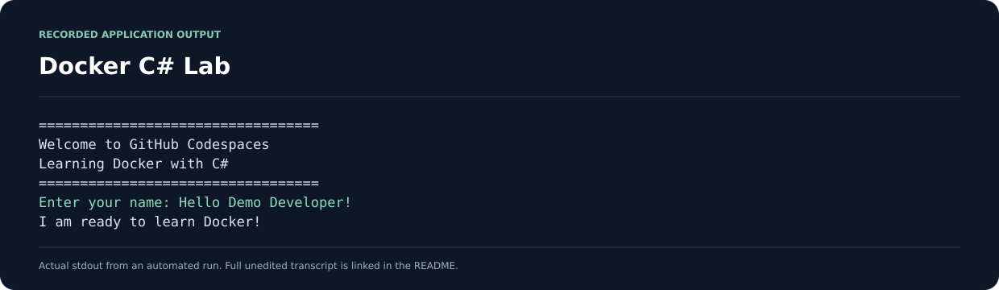

# Docker C# Lab

[](https://github.com/Nkosinathi-bit/Docker-CSharp-Lab/actions/workflows/ci.yml)

**Introductory coursework · CNA 271 · C# and Docker**

A small C# console exercise for learning how an application is built and run inside a Docker container.

**Module:** CNA 271 · Belgium Campus  
**Author:** Nkosinathi Mathenjwa

## Output preview

The image below presents output recorded from a real automated application run. It is a console-output excerpt; the program uses a terminal interface.



[Full unedited output](docs/screenshots/console-output.txt) · [Capture source and sample input](docs/screenshots/capture.json)

## What the application does

The application prints a welcome message, asks for your name and displays a personalised greeting.

## Run with .NET

Install the .NET 10 SDK and run from the repository root:

```bash
dotnet run --project HelloDocker/HelloDocker.csproj
```

## Run with Docker

Install Docker and run:

```bash
docker build -t hello-docker .
docker run --rm -it hello-docker
```

The multi-stage Dockerfile builds the application using the .NET SDK and copies the published files into a smaller runtime image.

## Repository structure

```text
HelloDocker/
  HelloDocker.csproj
  Program.cs
Dockerfile
.dockerignore
.gitignore
.github/workflows/ci.yml
README.md
```

Generated `bin/` and `obj/` folders are excluded from version control. Build output is recreated by .NET or Docker.

## Learning focus

- C# console input and output
- .NET project structure
- Docker image builds and interactive containers
- Keeping source files separate from generated output

This is an introductory learning exercise.

